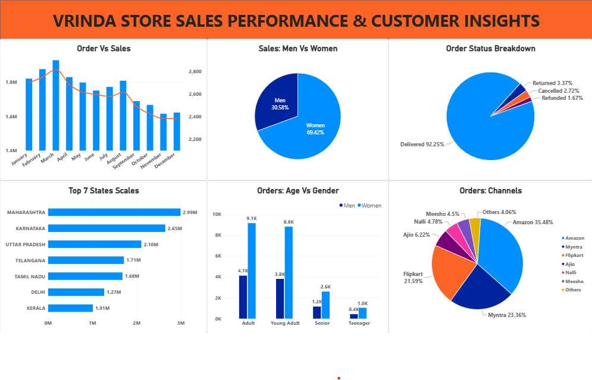

# Vrinda Store Sales Performance & Customer Insights Dashboard

## Questions (KPIs)
* Compare the sales and orders using a single chart.
* Which month got the highest sales and orders?
* Who purchased more - Men or Women?
* What are different order statuses in 2022?
* List top 10 states contributing to the sales.
* Relation between age and gender based on number of orders.
* Which channel is contributing maximum to the sales?
* Highest selling category?
* Percentage of total orders delivered.
* Dashboard Interaction: [View Dashboard File](Vrinda_Store_Dashboard)

---

## Process
* Conducted a programmatic unique value inspection across all columns to detect formatting inconsistencies and anomalies using [notebooks](notebooks/).
* Checked and removed duplicate rows to maintain data integrity.
* Standardized column data types, specifically resolving formatting issues within quantity fields (Qty) and cleaning text attributes.
* Loaded the preprocessed source data from [data](data/) to build an interactive, card-based analytics dashboard in Power BI.

---

## Dashboard

---

## Project Insight
* Women customers are more likely to buy products compared to men (~65%).
* The states of Maharashtra, Karnataka, and Uttar Pradesh are the top 3 product buyers.
* The adult age group (30-49 yrs) is max contributing (~50%) and buys the most products.
* The maximum number of products customer orders from Amazon, Flipkart, and Myntra channels.
* More than 90% of the products delivered successfully.

---

## Final Conclusion:
To improve the sales of Vrinda Store, a strategic marketing plan focused on women aged 30-49 years residing in Maharashtra, Karnataka, and Uttar Pradesh should be implemented. This demographic represents a key consumer segment, as they often make significant household and lifestyle purchases. The approach should include targeted digital marketing campaigns and personalized promotions to capture their attention.

---
Developed by **Faizan Muhammad** — Data Scientist  
[GitHub Profile](https://github.com/faizanmuhammed909)